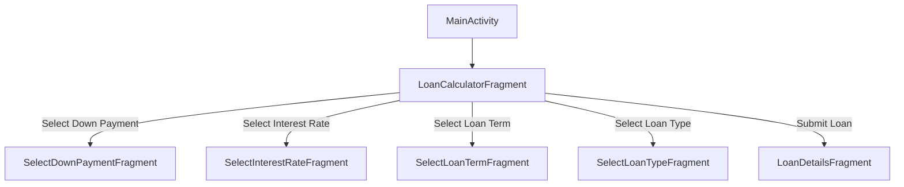

# Android Assessment 2 - Review Notes & Architecture Guide

This document provides a comprehensive review of the design patterns, architecture, and code implemented for Assessment 2 (Loan Calculator App).

## 1. Architecture Overview: Single-Activity Architecture

The application follows the **Single-Activity Architecture** recommended by modern Android guidelines:
- **`MainActivity`** acts as the single host container (`FrameLayout` / `FragmentContainerView` with ID `R.id.main`).
- **Fragments** (`LoanCalculatorFragment`, selection fragments, and `LoanDetailsFragment`) represent individual screens or UI states.
- Navigation between screens is performed dynamically using `FragmentManager` transactions (`replace()`, `addToBackStack()`, and `popBackStack()`).



---

## 2. Fragment Communication via Interfaces (Callbacks)

To allow child fragments to communicate upward with `MainActivity` without tightly coupling fragments to the activity, **custom listener interfaces** are used.

### Example: `SelectDownPaymentFragment`
1. **Define Interface inside Fragment:**
   ```java
   public interface FragmentSelectDownPaymentListener {
       void onLoanDownPaymentSelected(String downPayment);
   }
   ```
2. **Attach & Validate in `onAttach()`:**
   ```java
   @Override
   public void onAttach(@NonNull Context context) {
       super.onAttach(context);
       if (context instanceof FragmentSelectDownPaymentListener) {
           mListener = (FragmentSelectDownPaymentListener) context;
       } else {
           throw new RuntimeException(context + " must implement FragmentSelectDownPaymentListener");
       }
   }
   ```
3. **Trigger Callback on User Action:**
   ```java
   listView.setOnItemClickListener((parent, view, position, id) -> {
       if (mListener != null) {
           mListener.onLoanDownPaymentSelected(downPayments.get(position));
       }
   });
   ```
4. **Handle in `MainActivity`:**
   `MainActivity` implements `FragmentSelectDownPaymentListener`, stores the selected value, and pops the back stack to return to the calculator screen.

---

## 3. Custom Adapters (`ArrayAdapter`)

When displaying complex objects (like `LoanTerm` or `LoanType`) rather than simple strings, custom `ArrayAdapter` subclasses are implemented to inflate custom row layouts (`row_item_loan_term.xml` and `row_item_loan_type.xml`).

> [!TIP]
> **View Recycling (`convertView`)**: Custom adapters check if `convertView == null` before inflating a new row layout. If `convertView` is not null, it is reused, which drastically improves `ListView` scrolling performance.

```java
private class LoanTermAdapter extends ArrayAdapter<Data.LoanTerm> {
    public LoanTermAdapter(@NonNull Context context, @NonNull List<Data.LoanTerm> objects) {
        super(context, 0, objects);
    }

    @NonNull
    @Override
    public View getView(int position, @Nullable View convertView, @NonNull ViewGroup parent) {
        if (convertView == null) {
            convertView = LayoutInflater.from(getContext()).inflate(R.layout.row_item_loan_term, parent, false);
        }

        Data.LoanTerm loanTerm = getItem(position);
        TextView textViewYears = convertView.findViewById(R.id.textViewYears);
        TextView textViewDesc = convertView.findViewById(R.id.textViewDesc);
        ImageView imageView = convertView.findViewById(R.id.imageView);

        if (loanTerm != null) {
            textViewYears.setText(loanTerm.getName());
            textViewDesc.setText(loanTerm.getDescription());
            imageView.setImageResource(loanTerm.getImage_res_id());
        }

        return convertView;
    }
}
```

---

## 4. Financial Calculations in `LoanDetailsFragment`

Once the user submits the loan parameters, `LoanDetailsFragment` computes the loan summary using standard financial formulas:

1. **Down Payment Amount**:
   $$\text{DownPaymentAmount} = \text{Amount} \times \left(\frac{\text{DownPaymentPercent}}{100}\right)$$

2. **Principal (Loan Balance)**:
   $$\text{Principal} = \text{Amount} - \text{DownPaymentAmount}$$

3. **Monthly Interest Rate ($i$) & Total Months ($n$)**:
   - $i = \frac{\text{Annual Interest Rate}}{100 \times 12}$
   - $n = \text{Loan Term (Years)} \times 12$

4. **Monthly Payment ($M$) (Amortization Formula)**:
   $$M = P \frac{i(1+i)^n}{(1+i)^n - 1}$$
   *(Where $P$ is the Principal)*

5. **Total Payment & Total Interest**:
   - $\text{TotalPayment} = M \times n$
   - $\text{TotalInterest} = \text{TotalPayment} - \text{Principal}$

---

## 5. Key Best Practices Followed
- **Static Factory Methods (`newInstance`)**: Used across all fragments to pass arguments safely via `Bundle`.
- **Serializable Models**: [`Loan`](file:///C:/Users/Luke/AndroidStudioProjects/Evaluation02/app/src/main/java/edu/charlotte/evaluation02/models/Loan.java) implements `Serializable` so it can be securely bundled and passed to `LoanDetailsFragment`.
- **Edge-to-Edge Support**: Enabled via `EdgeToEdge.enable(this)` in `MainActivity`.
